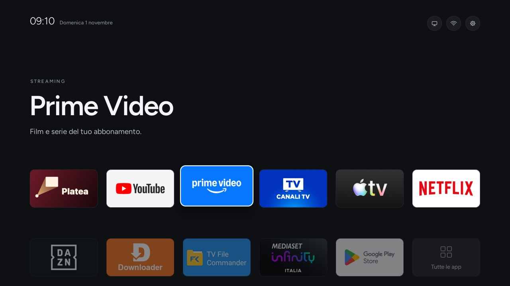
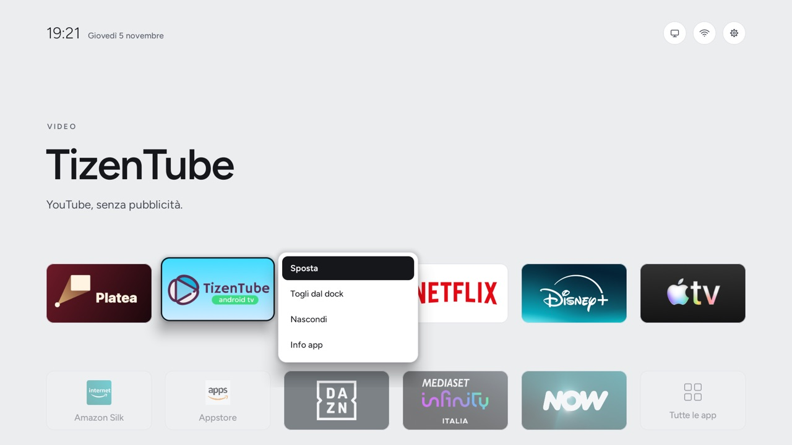
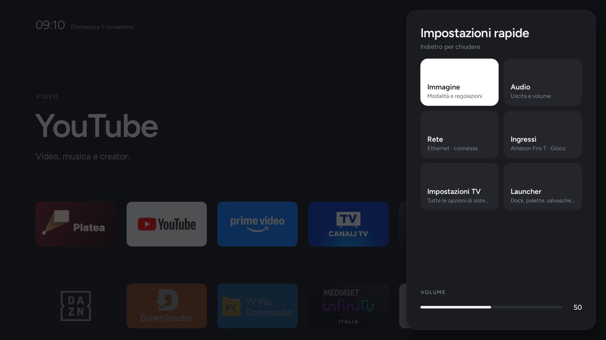
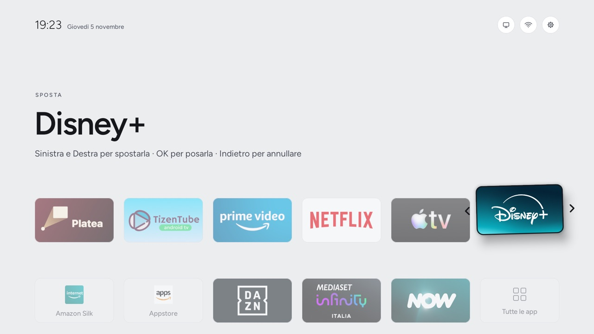
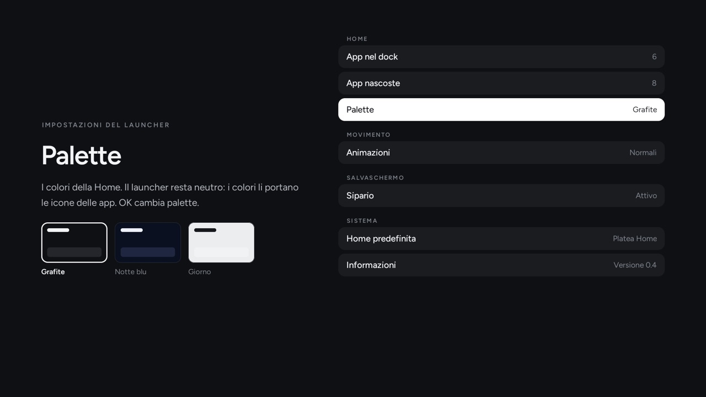
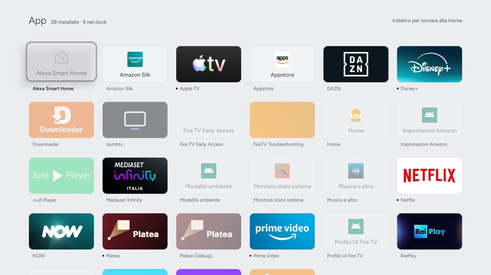
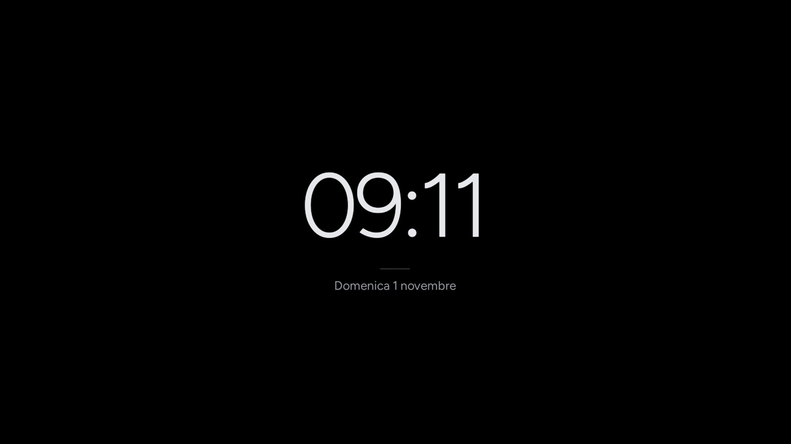

# Platea Home

Un launcher per Android TV e Google TV in stile tvOS: minimale, senza pubblicità, **senza accesso a internet**.

<p align="center"><i><a href="README.md">English</a> · Italiano</i></p>

**Usi un agente AI?** (Claude Code, Codex, Gemini CLI…) Clona il repo, aprilo nell'agente e incolla [`PROMPT.md`](PROMPT.md): l'agente segue [`AGENTS.md`](AGENTS.md).
Il debloat non è nostro: è quello di [CleanYourTV](https://github.com/Gathin23/cleanyourtv), con i suoi elenchi testati
per modello, preso sempre all'ultima versione. Platea Home fa solo da Home.

Design: il mockup "Platea Home" (Home, TV e ingressi, App, Sipario, pannelli). Font Figtree, palette Grafite.

<p align="center">
  
</p>
<p align="center">
  
  
  
  
  
  
</p>
<p align="center"><sub>Screenshot reali da una Fire TV Stick 4K Max in italiano, con la palette Giorno.</sub></p>

## Avvio rapido
**Con un agente AI:** clona il repo, aprilo nell'agente e incolla [`PROMPT.md`](PROMPT.md).

**A mano**, senza strumenti di build (serve solo [`adb`](https://developer.android.com/tools/releases/platform-tools)):
1. Sulla TV attiva **Opzioni sviluppatore** (Impostazioni → Sistema → Info, premi *Build* 7 volte) e poi il **debug USB
   / di rete**. Segnati l'indirizzo IP della TV, che trovi in Impostazioni → Rete.
2. Clona il repo e scarica `platea-home.apk`: l'ultimo è sempre a
   <https://github.com/Gionnio/platea-home/releases/latest/download/platea-home.apk>.
   ```bash
   git clone https://github.com/Gionnio/platea-home && cd platea-home
   ```
3. Installalo e rendilo la Home. La prima volta premi **Consenti** sulla TV:
   ```bash
   APK=platea-home.apk SIPARIO=1 TV_HOST=<ip> ./platea-home.sh install
   ```
4. Facoltativo: debloat con l'elenco CleanYourTV del tuo modello esatto. Leggi prima l'elenco e commenta le app che usi:
   ```bash
   TV_HOST=<ip> ./platea-home.sh debloat examples/<tuo-modello>/debloat.txt
   ```
5. Per tornare indietro: `TV_HOST=<ip> ./platea-home.sh restore`. Il debloat si annulla con il comando
   `tools/restore.sh` che il passo 4 ha stampato.

L'APK della release parte con un dock di serie fatto di YouTube, Netflix, Prime Video, Disney+, lo store e
Impostazioni, o le loro versioni Fire TV, a seconda di quelle installate. Lo
cambi tenendo premuto OK su un'app, oppure compilandolo con il tuo config (vedi sotto).

## TV provate
| TV | Android | Esito |
|---|---|---|
| Sony BRAVIA (piattaforma VH1, 2020), firmware EU | Android TV 12 | Tutto funziona, compresi i nomi dei dispositivi HDMI-CEC |
| Fire TV Stick 4K Max (2ª gen.), Fire OS 8.1.8.5, tramite il Guard di dumbtv ([issue #2](https://github.com/Gionnio/platea-home/issues/2)) | Fire OS 8 (Android 11) | Si avvia in Platea Home; Home da un'app lo apre; circa 45 MB di RAM |
| TCL (piattaforma C06, firmware V8-T221T05-LF1V325) ([issue #1](https://github.com/Gionnio/platea-home/issues/1)) | Android TV 11 | Schermata iniziale predefinita dopo il riavvio, persistenza del dock, app/ingressi/comandi rapidi/impostazioni, telecomandi fisici e Sipario funzionanti. I nomi dei dispositivi HDMI-CEC non sono stati testati in modo specifico. |

**Lo provi su un'altra TV?** Apri una issue con modello, versione di Android e firmware, cosa va e cosa no, e gli
screenshot. Senza indirizzi IP né nomi di rete.

## Cosa c'è (versione 0.5)
- **Home**:
  - ora e data, con tre pulsanti tondi: Ingressi, Rete, Impostazioni;
  - top shelf testuale: categoria, nome dell'app, una riga;
  - dock a 6 app, con il focus bianco che solleva la tessera;
  - una riga attenuata con le altre app e "Tutte le app".
- **OK tenuto premuto** su un'app (oppure il tasto Menu): Sposta, Togli dal dock, Aggiungi al dock, Nascondi, Sposta in una cartella, Info app.
  **Aggiungi al dock** porta alla Home con l'app pronta da spostare, così scegli il posto. Con il dock pieno diventa
  **Sostituisci nel dock**: Sinistra e Destra scelgono quale app sostituire.
- **Sposta**: l'app si solleva; Sinistra e Destra la spostano, OK la posa, Indietro annulla.
- **App**: tutte le app, 6 per riga, e dalla fine di una riga si passa alla successiva. Le app del dock hanno un
  puntino, quelle nascoste sono attenuate.
- **Cartelle**: nella Home e nella pagina App, mai nel dock. Una cartella mostra le prime quattro app; OK la apre,
  Indietro la chiude. I nomi si scelgono da una lista (Streaming, Sport, TV, Musica, Giochi, Bambini, Utilità, Altro),
  così non si scrive col telecomando. OK tenuto premuto su una cartella la rinomina o la elimina (le app restano).
- **Sipario**: salvaschermo con ora, linea e data su nero, che si sposta un poco ogni minuto.
- **Pannello rapido** (ingranaggio): Immagine, Audio, Rete, Ingressi, Impostazioni TV, Launcher, più il volume regolabile con Sinistra e Destra.
- **Rete**: tipo di connessione, se c'è internet, indirizzo, nome e velocità del Wi-Fi; scorciatoie alle impostazioni di rete. Legge lo stato con due permessi "normali": nessun accesso a internet.
- **Ingressi**: TV in diretta (i sintonizzatori uniti in una voce) e porte HDMI con il nome del dispositivo CEC, acceso o in standby; le porte vuote sono raccolte in "Altri ingressi".
- **Impostazioni del launcher**: app nel dock e nascoste, cartelle sì o no, palette (Grafite, Notte blu, Giorno, oppure **automatica**: Giorno dall'alba al tramonto, poi Grafite o Notte blu) con anteprima, animazioni ridotte, Sipario, Home predefinita, informazioni.
- **Lingue**: inglese e italiano, secondo la lingua della TV.
- **Peso**: APK di circa 115 KB. Sulla Sony BRAVIA VH1 la Home usa circa 22 MB di RAM appena avviata e circa 39 MB dopo aver aperto pannelli e impostazioni. Alba e tramonto per la palette automatica si calcolano sulla TV dal fuso orario, senza posizione e senza rete.

Da fare: prove su altre marche e su un box Google TV.

## Fire TV
Fire OS tiene la Home di Amazon qualunque cosa si imposti, ma Platea Home funziona tramite il Guard di
[dumbtv](https://github.com/humblemuzzu/dumbtv), con una piccola patch: istruzioni in [`firetv/README.md`](firetv/README.md)
(in inglese). Su Fire OS `platea-home.sh` installa l'app senza provare a cambiare la Home, e Platea Home nasconde da solo
le schermate di sistema di Amazon.

## Comandi
| Comando | Cosa fa |
|---|---|
| `./platea-home.sh build` | Compila `build/platea-home.apk` (`CONFIG=<json>` per la configurazione della TV) |
| `TV_HOST=<ip> ./platea-home.sh install` | Installa e rende Home in modo sicuro (`SIPARIO=1` imposta anche il salvaschermo) |
| `TV_HOST=<ip> ./platea-home.sh debloat <elenco>` | Debloat con `tools/disable.sh` dell'ultima CleanYourTV (es. `examples/sony-bravia-4k-vh1/debloat.txt`) |
| `TV_HOST=<ip> ./platea-home.sh restore` | Ridà la Home e il salvaschermo di prima, riattiva i launcher di serie disattivati, rimuove Platea Home |
| `TV_HOST=<ip> ./platea-home.sh status` | Home attuale, versione, memoria |

**Installazione sicura:**
1. Platea Home deve aprirsi davvero (`am start -W`) prima di diventare la Home.
2. Un launcher di serie Google viene disattivato solo se la TV continua a preferirlo.
3. Se la Home non passa a Platea Home, torna quella di prima.

Lo stato per ogni TV (Home e salvaschermo di prima, launcher disattivati) è in `state/<ip>/`.

## Configurazione
Un file JSON messo nell'APK alla build (`config/default.json` di serie):

| Chiave | Significato |
|---|---|
| `dock` | Le app del dock, in ordine (massimo 6; quelle non installate si saltano) |
| `hidden` | App da non mostrare nella riga della Home (restano nella pagina App) |
| `live_tv` | App della TV in diretta, aperta dalla voce "TV in diretta" del pannello Ingressi |
| `palette` | `Grafite`, `Notte blu`, `Giorno`, oppure `Auto Grafite` / `Auto Notte blu`: Giorno di giorno e quella palette di notte (si cambia anche dalle impostazioni sulla TV) |
| `sipario_palette` | `Nero`, `Grafite`, `Notte blu` |
| `lines` | `{"pacchetto": ["CATEGORIA", "riga"]}` in aggiunta a quelle di serie (`Config.java`) |

Le scelte fatte sulla TV (ordine del dock, app nascoste) restano sulla TV e vincono sul config.

## Build
Senza Gradle: `aapt2`, `javac`, `d8`, `apksigner` (`build.sh`). Servono:
- JDK 17 (`JAVA_HOME`, di serie Corretto 17);
- Android SDK con `platforms;android-34` e `build-tools;36.0.0` (`ANDROID_HOME`, di serie quello di Homebrew).

La chiave di firma si crea al primo build in `keys/platea-home.keystore`. **Non è su GitHub**: va tenuta in un posto
sicuro, perché senza la stessa chiave l'app installata non si aggiorna e andrebbe disinstallata.

## Licenze
- Codice di questo repo: MIT (`LICENSE`).
- Figtree: SIL Open Font License 1.1, © The Figtree Project Authors (`app/assets/fonts/FIGTREE-OFL.txt`).
- CleanYourTV (usato solo per il debloat, non incluso): MIT, © Gathin.
