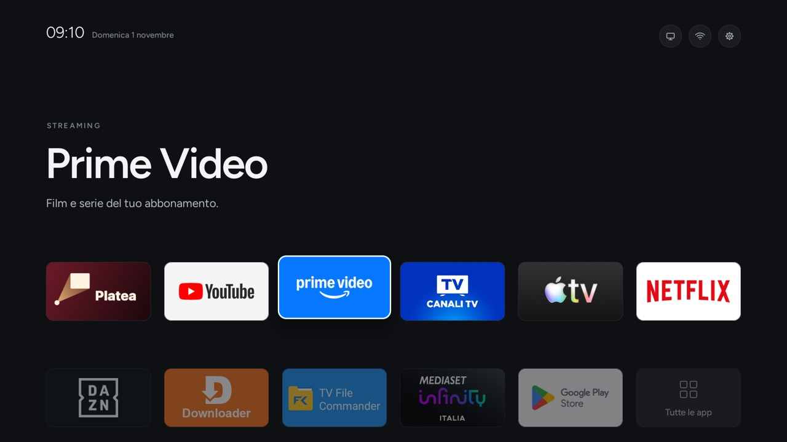
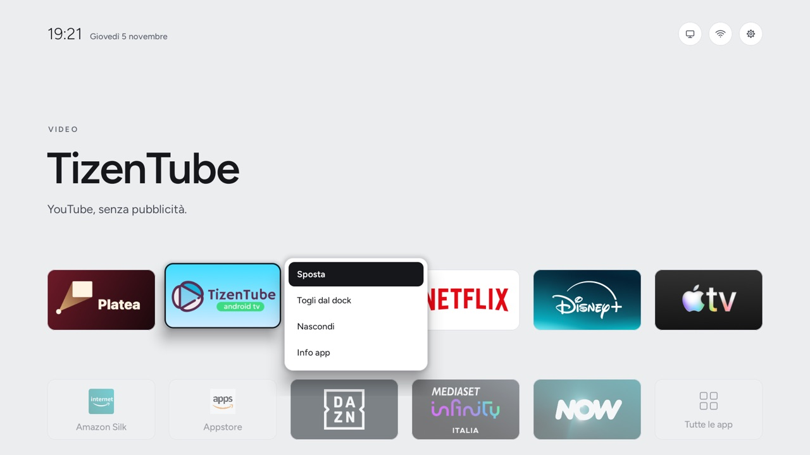
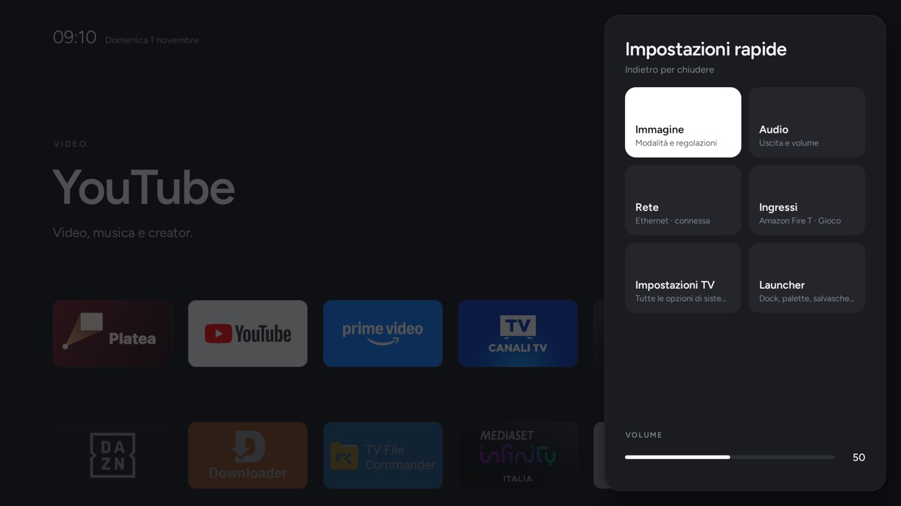
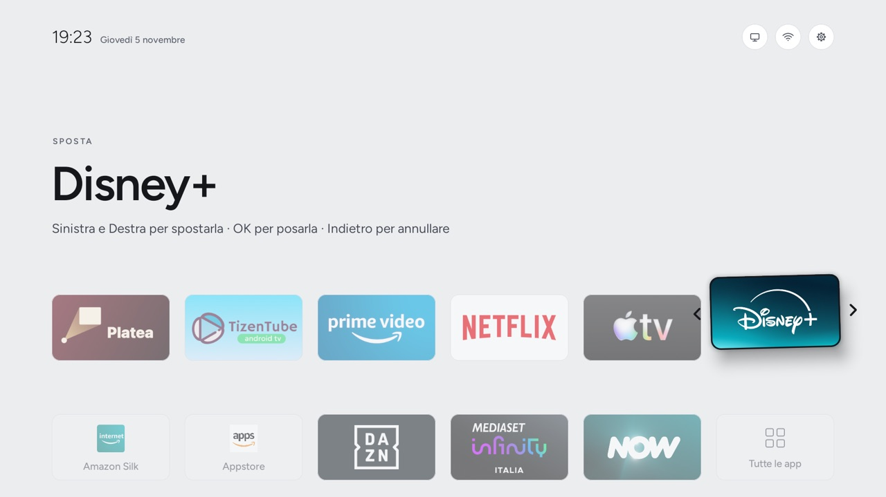
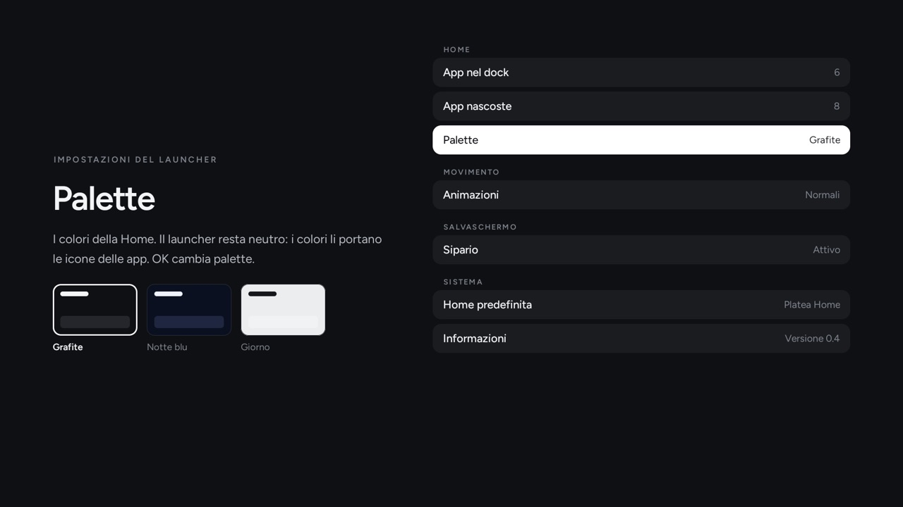
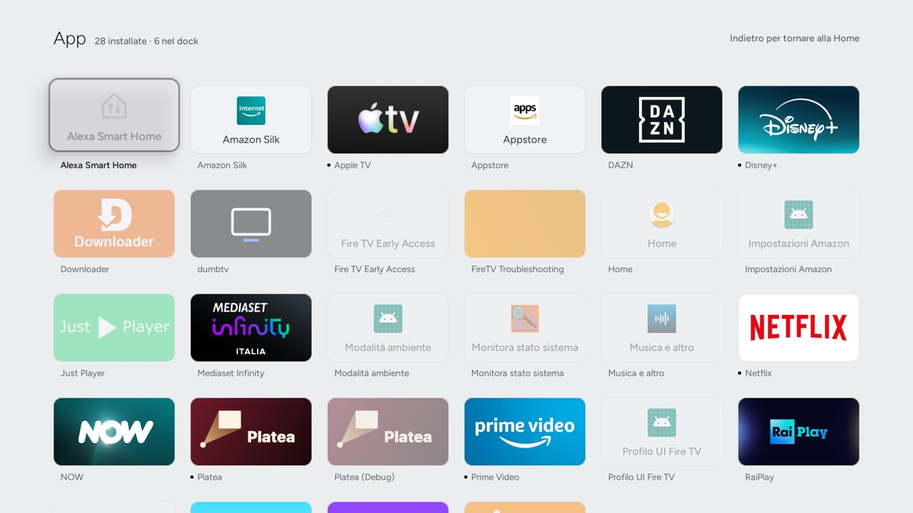
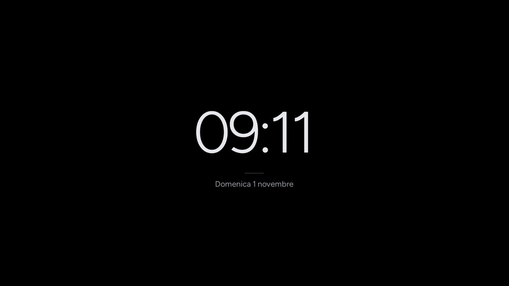

# Platea Home

A calm, tvOS-style home screen for Android TV and Google TV. **No ads, no sponsored rows, no internet access.**

<p align="center"><i>English · <a href="README.it.md">Italiano</a></i></p>

Platea Home only replaces the home screen. Debloating is done by [CleanYourTV](https://github.com/Gathin23/cleanyourtv)
and its lists tested model by model, always fetched at their latest version. Platea Home never duplicates them.

**Using an AI coding agent?** (Claude Code, Codex, Gemini CLI…) Clone this repo, open it in the agent and paste
[`PROMPT.md`](PROMPT.md). The agent follows [`AGENTS.md`](AGENTS.md).

<p align="center">
  
</p>
<p align="center">
  
  
  
  
  
  
</p>
<p align="center"><sub>Real screenshots from a Fire TV Stick 4K Max set to Italian, with the Day palette. The interface follows the TV's language (English or Italian).</sub></p>

## Quick start
**With an AI agent:** clone the repo, open it in the agent and paste [`PROMPT.md`](PROMPT.md).

**By hand**, with no build tools (just [`adb`](https://developer.android.com/tools/releases/platform-tools)):
1. On the TV, turn on **Developer options** (Settings → System → About, press *Build* 7 times) and then **USB / network
   debugging**. Note the TV's IP address, shown under Settings → Network.
2. Clone this repo and download `platea-home.apk`: the latest one is always at
   <https://github.com/Gionnio/platea-home/releases/latest/download/platea-home.apk>.
   ```bash
   git clone https://github.com/Gionnio/platea-home && cd platea-home
   ```
3. Install it and make it Home. Press **Allow** on the TV the first time:
   ```bash
   APK=platea-home.apk SIPARIO=1 TV_HOST=<ip> ./platea-home.sh install
   ```
4. Optional: debloat with the CleanYourTV list for your exact model. Read the list first, and comment out the apps
   you use:
   ```bash
   TV_HOST=<ip> ./platea-home.sh debloat examples/<your-model>/debloat.txt
   ```
5. To undo it all: `TV_HOST=<ip> ./platea-home.sh restore`. Undo the debloat with the
   `tools/restore.sh` command that step 4 printed.

The release APK starts with a default dock built from YouTube, Netflix, Prime Video, Disney+, the app store and
Settings, or their Fire TV versions, whichever are installed. Hold OK on
an app to change it, or build your own with a config (see below).

## Tested on
| TV | Android | Result |
|---|---|---|
| Sony BRAVIA (VH1 platform, 2020), EU firmware | Android TV 12 | Everything works, including HDMI-CEC device names |
| Fire TV Stick 4K Max (2nd gen), Fire OS 8.1.8.5, through dumbtv's Home guard ([issue #2](https://github.com/Gionnio/platea-home/issues/2)) | Fire OS 8 (Android 11) | Boots into Platea Home; Home from an app opens it; about 45 MB of RAM |
| TCL (C06 platform, firmware V8-T221T05-LF1V325; retail model pending) ([issue #1](https://github.com/Gionnio/platea-home/issues/1)) | Android TV 11 | Default Home after reboot, dock persistence, Apps/Inputs/quick controls/settings, physical remote controls and Sipario passed. HDMI-CEC device names not specifically tested. |

**Testing it on another TV?** Please open an issue with the model, the Android version and firmware, what works and
what doesn't, and screenshots. Do not include IP addresses or network names.

## What you get
- **Home**:
  - the time and date, with three round buttons (Inputs, Network, Settings);
  - a text top shelf showing the focused app's category, name and one line about it;
  - a dock of 6 apps, where focus lifts the tile with a white border;
  - one dimmed row of other apps, ending with "All apps".
- **Hold OK** on an app (or press Menu): Move, Remove from dock, Add to dock, Hide, Move to a folder, App info. **Add to dock** takes
  you to Home with the app ready to move, so you pick its place. With a full dock it becomes **Replace in dock**:
  Left and Right choose which app to replace.
- **Move**: the app lifts; Left and Right move it, OK drops it, Back cancels.
- **Apps**: every app, 6 per row, wrapping from the end of a row to the next. Dock apps have a dot, hidden apps
  are dimmed.
- **Folders**: on Home and on the Apps page, never in the dock. A folder shows its first four apps; OK opens it, Back
  closes it. Names come from a short list (Streaming, Sport, TV, Music, Games, Kids, Tools, Other), so there is no
  typing with the remote. Hold OK on a folder to rename it or delete it (its apps stay).
- **Quick settings** (gear), as a side panel: Picture, Sound, Network, Inputs, TV settings, Launcher, and a volume
  bar (Left and Right).
- **Network**: the connection type, internet yes or no, IP address, Wi-Fi name and speed, with shortcuts to the TV's
  network settings. Android only shows the Wi-Fi name to apps with the location permission: the install script grants
  it, and the app never reads the location (it has no internet access anyway).
- **Inputs**: Live TV (all tuners in one entry) and the HDMI ports, with the device name read over HDMI-CEC, on or in
  standby. Empty ports are folded under "Other inputs".
- **Launcher settings**: the dock and hidden apps, folders on or off, the palette (Graphite, Night blue, Day, or **automatic**: Day from sunrise to sunset, then Graphite or Night blue) with a preview, reduced
  animations, the screen saver, the default Home and an About page.
- **Sipario**: a screen saver with the time, a line and the date on black, which moves a little every minute.
- **Languages**: English and Italian, following the TV's language.

On a Sony BRAVIA VH1 (Android TV 12), Platea Home uses about **22 MB of RAM** right after it starts and about 39 MB
after the panels have been opened. The APK is about **115 KB**. Sunrise and sunset for the automatic palette are worked
out on the TV from its time zone, with no location and no network. It needs Android 8.0 or later (API 26).

## Commands
| Command | What it does |
|---|---|
| `./platea-home.sh build` | Builds `build/platea-home.apk` (`CONFIG=<json>` for the TV's configuration) |
| `TV_HOST=<ip> ./platea-home.sh install` | Installs it and makes it Home, safely (`SIPARIO=1` also sets the screen saver) |
| `TV_HOST=<ip> ./platea-home.sh debloat <list>` | Debloats with `tools/disable.sh` from the latest CleanYourTV, e.g. `examples/<model>/debloat.txt` |
| `TV_HOST=<ip> ./platea-home.sh restore` | Gives back the previous Home and screen saver, enables the stock launchers it disabled, removes Platea Home |
| `TV_HOST=<ip> ./platea-home.sh status` | Current Home, version, memory |

**Safe install:**
1. Platea Home must really open (`am start -W`) before it becomes Home.
2. A stock Google launcher is disabled only if the TV keeps preferring it.
3. If Home does not move to Platea Home, the previous Home is put back.

The state for each TV (the previous Home and screen saver, the launchers disabled) is kept in `state/<ip>/`.

## Configuration
A JSON file is built into the APK; the default is `config/default.json`. Copy it for each TV.

| Key | Meaning |
|---|---|
| `dock` | Dock apps in order: at most 6, and apps that are not installed are skipped |
| `hidden` | Apps kept out of the row on Home (they stay on the Apps page) |
| `live_tv` | The live TV app opened by "Live TV" in the Inputs panel |
| `palette` | `Grafite`, `Notte blu` or `Giorno` (Graphite, Night blue, Day), or `Auto Grafite` / `Auto Notte blu` for Day by day and that palette at night; it can also be changed on the TV |
| `sipario_palette` | `Nero`, `Grafite` or `Notte blu` |
| `lines` | `{"package": ["CATEGORY", "line"]}`: top-shelf text added to the built-in lines (`res/values*/strings.xml`) |

Choices made on the TV (the dock order, hidden apps, the palette) stay on the TV and win over the config.

## Build
No Gradle: `build.sh` runs `aapt2`, `javac`, `d8` and `apksigner`. You need:
- JDK 17 (`JAVA_HOME`);
- the Android SDK with `platforms;android-34` and `build-tools;36.0.0` (`ANDROID_HOME`, by default Homebrew's
  `android-commandlinetools`).

The signing key is created on the first build in `keys/platea-home.keystore`, which is git-ignored. **Back it up**:
without the same key the installed app cannot be updated and has to be removed first.

## Fire TV
Fire OS keeps Amazon's Home whatever you set, but Platea Home works through the Home guard of
[dumbtv](https://github.com/humblemuzzu/dumbtv), with a small patch. See [`firetv/README.md`](firetv/README.md). On Fire
OS, `platea-home.sh` installs the app without trying to change Home, and Platea Home hides Amazon's system screens on its
own.

## Not supported
- **Samsung, LG and Roku**: they are not Android TV.

## Licences
- This repo's code: MIT ([`LICENSE`](LICENSE)).
- Figtree: SIL Open Font License 1.1, © The Figtree Project Authors ([`app/assets/fonts/FIGTREE-OFL.txt`](app/assets/fonts/FIGTREE-OFL.txt)).
- CleanYourTV is used for debloating only, downloaded at run time and not included: MIT, © Gathin.
